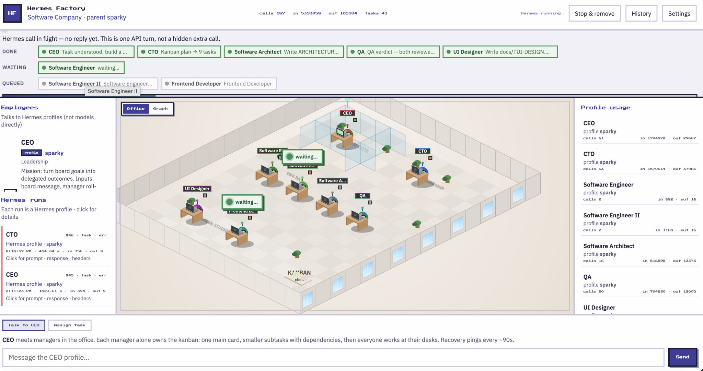

# Hermes Factory

> **WIP** — usable local factory UI + Python orchestration harness. Expect rough edges (long oneshots, dual client/server orch paths, inspector wiring). Not a multi-user/remote product.

Company of Hermes **template positions** — isometric office UI on **real** Hermes profiles. You message the board (CEO); the company plans on a factory kanban, works at desks, QA’s, and delivers back. Templates and positions are editable and stored on disk.

**State of truth = the template.** Profile usage, floor status, mission steps, and the factory kanban all track **roles** (`swe`, `architect`, …). Each role runs via that role’s mapped Hermes profile (`settings.roleProfiles` → e.g. `sparky`). Do not treat role ids as Hermes profile names, and do not use Hermes Agent’s external kanban for factory work.

### TODO

- [ ] Drop legacy browser `runOrgChain` once server orch is the only path
- [x] Surface hung Hermes oneshots (timeout / cancel) instead of “ACTIVE” forever
- [ ] Stream every server `hermes_run` into left **Hermes runs** (prompt · response) after bridge restart
- [ ] Server-side resume after refresh (ready kick / ping) without client timers
- [ ] Optional per-mission workspace: `workspacePath/<missionId>/`
- [ ] Tighten Settings → workspace “Open folder” + clearer 402 / wrong-profile hints
- [ ] Trim `command.js` to a thin WS client; keep office / graph / kanban UI

## Showcase



A live Software Company run: CEO briefed the board ask, CTO owns the kanban (9 tasks), roles move through **Done / Active / Waiting / Queued**, green **waiting…** bubbles mark dep-blocked desks, and the left **Hermes runs** list shows real `sparky` oneshots you can open for prompt · response · headers.

### What you need

| Need | Notes |
|------|--------|
| **Hermes CLI** | Installed and on your PATH (default `~/.local/bin/hermes`) |
| **Hermes profiles** | At least one under `~/.hermes` (e.g. `sparky` / local model — avoid silent `default`/Nous if you want local AI) |
| **Model auth** | **No API key in Hermes Factory.** Keys / providers live in the Hermes profile (`~/.hermes`, `auth.json` / profile config). Factory only runs `hermes -p <profile> -z …` |
| **Python 3.9+** | For the FastAPI bridge (`pip3 install -r server/requirements.txt`) |
| **Browser** | Open the local UI at `http://127.0.0.1:8787` |
| **Workspace folder** | Absolute path under your home (Settings → Default workspace); all agent cwd work stays there |

Optional: clone/edit the company template in Settings (roles, org lines, avatar style, palette). If a run hits **HTTP 402 / Nous credits**, the call used cloud Nous — set Settings **parent profile** to your local profile (e.g. `sparky`) and Save.

### How to use it

1. **Start the bridge** (see [Run](#run) below) and open the UI.
2. **Settings** — set **parent profile** (e.g. `sparky`), **Hermes binary**, and **workspace**. Save & apply.
3. **Talk to CEO** — type a board ask in the dock (“Message the CEO profile…”) and Send.
4. **Watch the floor** — CEO delegates → CTO plans MAIN + SUB cards → ready roles work at desks; blocked roles show **waiting…** (click the bubble for the task).
5. **Kanban** — click the floor **KANBAN** table to inspect MAIN / columns / deps for a manager.
6. **Hermes runs** (left) — click a run for prompt, response, headers, usage.
7. **Office / Graph** — toggle the stage view; mission bar groups Done / Active / Waiting / Queued.
8. **When finished** — CEO must end with board delivery (`DELIVERED: yes`). Use **History** for past deliveries; **Stop & remove** to abort and clear.

Recovery pings (~90s) nudge managers while a mission is open. Orchestration runs on the server by default.

**Troubleshoot oneshots:** Factory runs a single `hermes -z` at a time (mutex). Desk work defaults to `hermesTimeoutSec=900`; recovery pings use `hermesPingTimeoutSec=180` (both in `~/.hermes-factory/settings.json`). Empty “timed out after Ns” means the Factory subprocess budget, not that Hermes is down — raise the setting for slow local models. After 3 consecutive oneshot failures the mission auto-pauses (clear ACTIVE / mid-desk cards); **Resume** when ready. HTTP **402** = cloud Nous credits / wrong parent profile, not a timeout.

## Run

```bash
cd hermes-factory
pip3 install -r server/requirements.txt
python3 server/bridge.py
# or: cd server && python3 -m factory
```

Open [http://127.0.0.1:8787](http://127.0.0.1:8787).

Orchestration (kanban waves, ping, CEO `DELIVERED`) runs in the **Python FastAPI harness** by default (`settings.orchestration = "server"`). Factory state lives in `~/.hermes-factory/factory.db`; Hermes oneshots use `settings.workspacePath` as cwd. UI listens on `/ws/events`.

```bash
cd hermes-factory/server && python3 -m pytest tests/ -q
```

## Settings → palette, templates & positions

Open **Settings**:

| Action | Where |
|--------|--------|
| **Color palette** | Colors section (office tiles follow the palette) |
| **Avatar style** | Robots · Aliens · Minecraft · Dinosaurs · Gummy bears |
| Pick Hermes parent profile / binary / **workspace** | Hermes section |
| **Orchestration** | Server (recommended) or legacy browser |
| Switch company template | Active template |
| Rename template | Display name |
| **Board talks to** | Orchestrator / board chat target (usually CEO) |
| **Add position** | Positions → title + department → Add |
| **Role kind** | Per role: orchestrator / manager / executor / evaluator |
| Edit org lines | Per role: **Takes orders from** + **Reports to** (required) |
| Edit / remove positions | Per-role rows (title, dept, kind, Hermes profile) |
| **Clone as new** company | Clone as new |
| Delete custom template | Delete template (not `software-company`) |
| **Save & apply** | Writes template + settings, remounts floor |

Hermes profile selects show the **effective** profile for each role (settings override → template → parent → `default`). Only spawnable profiles from `~/.hermes` are used.

### What the graph means

It is not a fixed pipeline. It is who may talk to whom.

1. The **orchestrator** (CEO) calls **managers to the CEO’s office**. They exchange what will be done. Managers leave. If more than one manager has work, they take **turns**.
2. A **manager** walks to the **factory kanban alone**, owns one **MAIN** card for the board request, and breaks it into **SUB** tasks for template positions (`TASK: <role_id> | …` with optional `AFTER:` deps).
3. The team stays at / returns to **desks**. Ready subs (deps satisfied) run via `runRole(position)` — that updates usage, mission, and floor status for that position.
4. When a card completes, dependents **unblock** (event-driven) and the next wave starts at desks.
5. QA runs after the team’s wave; then the manager can send more work or report up.
6. About every **~90s**, while a mission is open and the org chain is idle, the orchestrator and managers with open cards get a **recovery ping** (stuck cards, failed API, retry). Pings never abort an in-flight template run.

Click the **KANBAN** table on the floor. Pick a manager. You see the **main** board card plus columns: To do, **Blocked**, Doing, Review, Done. Subtasks show assignee + dependency labels.

### Role kinds (communication graph)

```
Board ⇄ Orchestrator ⇄ Manager → Executor ⇄ Manager (recovery / progress)
                                  │              ↑
                                  ↓              │
                             Evaluator ──────────┘
```

| Kind | Who | Behavior |
|------|-----|----------|
| `orchestrator` | Usually CEO | Board ↔ orch; orch → managers; start **and** end (`DELIVERED`) |
| `manager` | CTO / CFO… | Owns the factory kanban: MAIN + SUB plan with deps; recovery pings check that board |
| `executor` | Engineers, designer, frontend, architect | Normal positions at desks. No special “hub” executor — sequencing is **kanban dependencies** |
| `evaluator` | QC / QA | → manager only (validate; manager decides again) |

### Org chart (always in the template)

Every role **must** define reporting lines + `roleKind` in the company JSON:

| Role | `takesOrdersFrom` | `reportsTo` | `roleKind` |
|------|-------------------|-------------|------------|
| Board target (`orchestratorRoleId`, e.g. CEO) | `null` (Board) | `null` (Board) | `orchestrator` |
| Everyone else | **required** role id | **required** role id | `manager` / `executor` / `evaluator` |

| Field | Meaning |
|-------|---------|
| `takesOrdersFrom` | Who assigns work / gives orders |
| `reportsTo` | Structural next hop when finished (executors often → evaluator; managers → orchestrator) |
| `hermesProfile` | Default Hermes profile for that position (overridable in Settings → `roleProfiles`) |

### Software Company seed

Bundled at `server/seed/software-company.json`:

| Role | Kind | Takes orders from | Reports to |
|------|------|-------------------|------------|
| CEO | orchestrator | Board | Board |
| CTO | manager | CEO | CEO |
| SWE / SWE II / Architect | executor | CTO | QA |
| UI Designer | executor | CTO | QA |
| Frontend Developer | executor | CTO | QA |
| QA | evaluator | CTO | CTO |

Architect is a **normal executor**. If architecture must land first, the CTO puts that subtask first and other cards use `AFTER:` on it.

QA checks documentation, data sources, code quality, that work can run, and that no leftover process is still listening.

### Factory kanban plan shape (manager)

```
MAIN: <where/how the board request will be completed>
TASK: architect | Spec the model
TASK: swe | Implement core | AFTER: 1
TASK: designer | UI spec | AFTER: 1
TASK: frontend | Build UI | AFTER: 3
TASK_STATE: in_progress
```

`AFTER` uses 1-based TASK line numbers (or a prior role id). Omit `AFTER` when the task can start immediately.

### Workflow example (Software Company)

Board says: *“Ship a login fix.”*

1. **Board → CEO** — CEO takes the ask at their desk.
2. **CEO’s office** — managers walk in, exchange plan, leave. Turns if several managers.
3. **CTO at the kanban** — alone. Writes MAIN + SUB cards for template positions (with deps if needed).
4. **Back to desks** — ready positions run; blocked positions show a green **waiting…** bubble (click to see the task, click again to collapse).
5. **Waves** — finishing a card unblocks dependents; next wave runs at desks.
6. **QA** — factory sends the batch to QA, then CTO continues or reports up.
7. **CEO** — verifies and delivers when truly done. Recovery pings (~90s) while the mission stays open.

Mission bar is **not** a linear pipeline. Roles are grouped **Done / Active / Waiting / Queued** (parallel-friendly).

### Floor UI

| Element | Behavior |
|---------|----------|
| Green **waiting…** bubble | Position blocked on a dependency. Click → task text; click again → `waiting…` |
| Green ✓ sticky (CEO) | Board reply when delivered |
| Mission board | Status groups, not a numbered rail |
| Profile usage | Calls/tokens **per template position** (via that position’s Hermes profile) |

### Storage

| Path | Contents |
|------|----------|
| `~/.hermes-factory/settings.json` | Active template, theme, avatarStyle, **role→profile** map |
| `~/.hermes-factory/templates/*.json` | Full company templates (roles + org lines, desks, rooms) |
| `~/.hermes-factory/state.json` | Live mission, factory kanban, view (office/graph), run history |
| `~/.hermes-factory/history.json` | Delivered-task history |
| `server/seed/*.json` | Built-in seeds (copied once if missing; new bundled roles are merged in) |

## Work

- **Office / Graph** toggle on the stage (saved across refresh)
- **Talk to board target** / **Assign task** → real `hermes -p <profile> -z … --usage-file` for that **position’s** profile
- Org graph by role kind; manager owns factory kanban; executors run as template roles
- **History** — delivered tasks in `~/.hermes-factory/history.json`. Open missions restore after refresh
- **API history** — click a Hermes run for latency, headers, prompt, response, usage
- **Stop & remove** / Pause — abort in-flight chain, clear or freeze mission, unlock the dock

## Bridge API

| Method | Path |
|--------|------|
| GET | `/api/profiles` |
| GET/PUT | `/api/settings` |
| GET/PUT | `/api/state` |
| GET | `/api/history` |
| POST | `/api/history` |
| GET | `/api/templates` |
| GET/PUT/DELETE | `/api/templates/<id>` |
| POST | `/api/templates` `{ "name", "cloneFrom" }` |
| POST | `/api/run` `{ "profile", "prompt" }` |
